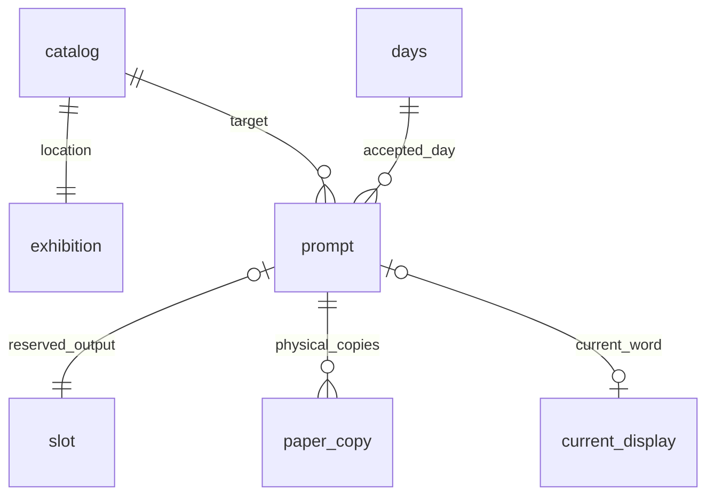

# data-model: 対象・引受け・表示と回収の根拠を保持する情報

## 依頼と粒度

| 依頼した層と決めるもの | 何のため | 求めた粒度 | この材料で満たしたか |
| --- | --- | --- | --- |
| [how-to-buildの設計](../../how-to-build/README.md#材料への依頼) | 同じQ17と対象/枠/状態/紙の根拠を保存しF0で消す | SQLiteの鍵・制約と読み書き、競合と終了の具体例 | 下記と[schema.sql](schema.sql)、[同じQ17の局所モデル検査](../technical-feasibility/model-observations.json)を受領。物理確認と実機は未実施 |

## 中身

### 読取りと変更から導いた意味

catalogのnumber/title/shelfは公開済みの写しの内容で、exhibitionのlocationは今回の合成の展示場所。17/A1は収蔵へ戻す対応、17/左室は今の案内であり別の事実。変更できる表示順を識別子にしない。
prompt.idは言葉を識別する値でcatalog.numberとは別。例のQ17は資料番号17と同じ文字があるだけで別の鍵。実装は衝突しないランダムなIDを発行し、受付キーは原札の控えと対応する。receiptは同じ依頼の再実行を見分け、revは本文の歴史ではなく状態の同時更新を見分ける。本文とsource/scope/numberは受理後に上書きしない。
slotはday/number/atで同じ出力枠を一意にし、prompt_id/day/numberの複合外部キーで、別の対象や別の日の問いを結ばない。paper_copyは印刷/転記して実際に置く一枚ごとのID。状態欄だけで回収せず、担当A/Bと確認時刻を付ける。
runtimeは現在の対象日・covered/open/endedとepoch。起動直後はcovered、日付/時計が掲示と違う場合も開けない。current_displayは各対象の現在の言葉で、元catalogとは別。土曜の最後の問いは、期限と取下げを再確認して日曜開始時に同じ対象へ出せる。
aggregateは延べ入室/出来事・任意の応答の分類件数と欠測だけ。氏名・端末ID・各来館者の経路・言葉の原文を持たない。

### 構造と、失ってはいけない関係

具体の定義は[schema.sql](schema.sql)。受理の追加と枠の確保は同じBEGIN IMMEDIATE transactionで行う。受理数はpromptの当日/同じnumberの累積件数で数え、withdrawnを除いて数え直さない。拒否した原札の本文を無制限にDBへ保存せず、拒否理由は集計で残す。終了した日は再受付を行わない。
current_displayが参照する問いのnumber・状態とbodyは処理側でも照合し、単に外部キーが存在するだけで『提供中』にしない。紙と画面の確認は外で起きる行いであり、仮のbitで済んだと推測しない。

### 読取りと更新の具体

受理はreceiptの既存結果を先に読み、digestが一致すれば同じ結果を返す。新規なら時刻/対象の累積4件/5分以上後の空き枠を確認し、promptのINSERTとslotのUPDATEをまとめてcommitする。枠が取れなければ全体をrollbackして未受理を返す。
現行はruntime.mode=open、PCの対象日と10:00〜11:25が一致し、current_displayとprompt.numberが一致、state=active、body非null、scopeが土日内である行だけを読む。coveredや期限外は本文を返さない。
古い状態の更新は `UPDATE prompt SET state=?,rev=rev+1 WHERE id=? AND rev=?` の変更行数で判定し、0件は409。どちらの画面も同じrevを読んだ後に一方が確定すると、もう一方はその古い結果で上書きしない。
F0は日曜の表示/紙の回収確認と集計後、current_displayの参照、paper_copy、slotのprompt参照、promptの本文/digest/受付キーを含む行を消す。受理数と提供確認/取下げ/未提供の件数は先にaggregateへ移す。個別の問いや受付キーを保守用logへ写さない。runtime=endedを保持し消去後の再送は410。secure_delete=ON、journal=DELETEで作り、終了後VACUUMする。OSの別backup・印刷物・印刷ジョブ・画面はDBだけでは消えず別途確認する。

### 比較した情報の持ち方

本文を上書きする表一枚だけでは、原札・紙のどれを回収するかと枠が分からない。全ての本文の版と操作履歴を永久に残す方式はF0と合わない。本文を受理後不変にし、状態rev・出力枠・現物コピーだけを分け、最終的に集計以外を消す案を返す。技術が原子性と制約を支え、実際の確認は体験/機能側が供給する必要がある。

## 確かめた方法と限界

必要な読取り/変更→対象と鍵→制約→同じQ17の予約/表示/取下げ→F0の順に往復して構造を組んだ。別の資料18の問いを17の枠へ結ぶ例、二接続の旧rev、土曜と日曜の差、消去後の再送を技術材料へ渡す。schemaは設計用で、実施設の保存・同時操作が観測済みとはしない。
