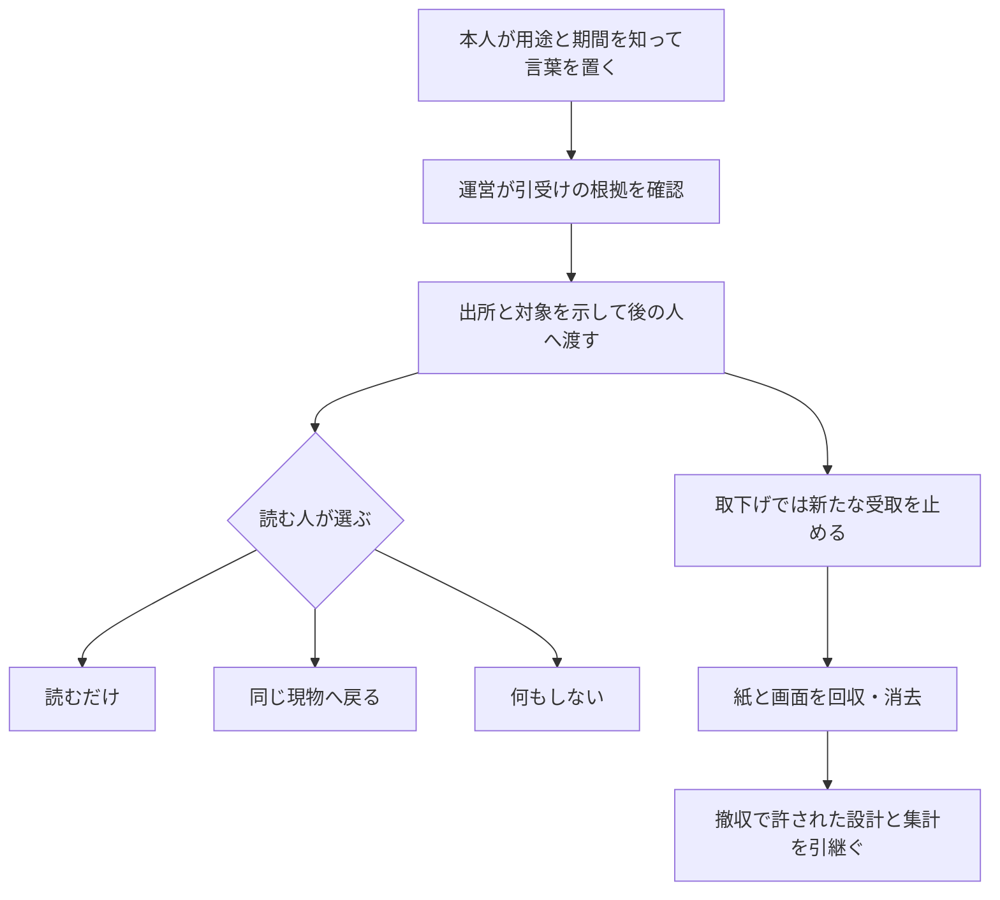

# experience-sketch: 同じ問いを受け取って物へ戻る候補の一巡

現在の設計は[選定後の具体](#選定後の依頼と全場面)を読む。初回の候補比較と当時の未確認は履歴として保ち、採用済みの根拠へ読み替えない。

## 依頼と粒度

| 依頼した層と決めるもの | 何のため | 求めた粒度 | この材料で満たしたか |
| --- | --- | --- | --- |
| [how-to-solveの候補](../how-to-solve/README.md#3-補う点ごとに選択肢を出す) | 紙・QR・局所制作で受取と運営がどう変わるか | 主要な一巡と見積りの画面 | 下記の同じQ17の差と、作る境界を返した。未採用 |
| [how-to-buildの全場面/画面](../how-to-build/README.md#材料への依頼) | 選定したK-Sを人/紙/端末の一巡として渡す | 全場面・全画面のラフと失敗の続き | [選定後の全場面](experience-sketch.md#選定後の依頼と全場面)へ育てた。実機と初見操作は未実施 |

## 中身

### 始点・終点と案の違い

土曜10:05、左室の袋17を見た人が『折り目は何度使った跡だろう』と問い、10:30に一人で来た人がそれを手がかりに同じ袋の折り目を見る構成例。来館者の実際の反応ではない。別の人は書かずに戻る。10:40に作者が取下げ、担当が交代する。



受領・引受け・提供・実際の見直しをそれぞれ別の出来事として辿る。

- P: 紙の基準。本人が期間欄を選んだ原札を運営が受け、番号と出所付きの札を物の横へ置く。受取人はその場で見て戻れる。取下げで紙を回収。交代は紙の対応表。後の人へ届く価値はこの新運用で既に生まれうる。
- Q: 元のQR着想。本人端末から短い問いを置き、一つ受取る。端末なしの紙経路は別に要る。公開配信・来館者端末でのキャッシュ・範囲外からの読取りと書込みの制御が増える。公開先が未取得なので成立は未確認。
- K: PC上で受領・適格性・出所・期間・表示と回収対象を一元管理。貸与端末の読取りと物の横の紙札へ同じ問IDを出す。本人は紙で問いを置き、受取人は紙だけでも進める。実話の公開や個人端末の接続を要しない。取下げでは貸与端末を覆い、紙を回収し、画面の現行を確かめる人の仕事が残る。
- R: 小さな読取り用ページ。運営が事前に作った三つの問いと、番号から展示場所へ戻る案内を端末で選べる。来館者の言葉の受渡し・取下げ・交代は紙だけで行う。制作は出所・期間の表示と対象への案内へ働くが、来館者の問いを端末へ反映する価値と一元管理を失う。

### 候補Kのラフと作る画面

```text
入口の貸与端末（読取り専用）
  何もしないで展示へ戻れます
  [17 袋→左室] [18 道具→右室] [19 写真→入口壁面]
  来館者の問い（期間:この土日だけ）
  『折り目は何度使った跡だろう』
  →同じ17の袋へ戻り、折り目を探してもよい
  [閉じる]   書かなくても読めます

PCの運営画面
  受領Q17 / 17袋 / 来館者の問い / 土日だけ / 本人の範囲選択確認
  状態:確認待ち（まだ渡していません）
  [内容と範囲を確認して提供準備] [提供しない]
  旧い画面なら『他の操作で変わりました。再読してください』
  [端末を覆い・旧札回収→現行の表示確認→提供開始]
  [取下げ準備] [表示と紙の回収を確認→取下げ完了]
```

紙の原札は番号・短い問い・土日内だけの提供選択・取下げ控え。掲示札は同じ問IDと出所・対象を持つ。来館者にPCを操作させない。状態の変更は運営が根拠を確かめる仕事であり、ボタンがあるだけで引受けや紙の回収が完了しない。

### 通して見えた欠けと不足

元の番号と展示場所を混ぜると、17をA1棚へ案内して現物へ戻れない。展示場所は別情報にする。取下げのDB更新だけなら表示済みの紙と端末が残るため、覆う・回収・画面再読の前後を流れへ追加した。受取るだけの人を投稿画面へ送らない。
全員へ説明する運用は加えず、選べる表示と紙経路を置く。実際に初見で分かるか、子と同行者が無理なく通れるかは実利用前の受入れとwhyの観測が未実施。

## 確かめた方法と限界

同じQ17の一巡、端末なし、取下げ、交代、撤収を各案へ机上で通した。実在者の使いやすさ・所要時間は取得していない。費用と方式の採否は依頼側へ返す。

## 選定後の依頼と全場面

[how-to-build](../how-to-build/README.md#材料への依頼)から、採用済みK-S・F0・対象別枠と休止を受け、全場面・全画面へ育てた。上のP/Q/K/Rは選定前の比較。現在の案はこの節から読む。

| 場面 | 見えるものと人の行い | 終わり/途中や失敗からの続き |
| --- | --- | --- |
| 初めて来る/端末を出さない | 入口と二室に『読むだけ・書かずに鑑賞へ戻るのも自由』、提供/受付時刻と対象別の枠。現物に書き込まず別札。子と同行者は望めば読み上げる | 書かずに戻れる。係が全員へ説明して回る仕事は加えない |
| 端末の選択→一つ読む | 17袋/左室、18道具/右室、19写真/入口壁面から一つ選ぶ。出所・土日だけ・問い本文と同じ物へ戻る案内 | 戻る/閉じるで内容を消す。読んだことを投稿や成功の記録にしない |
| 紙で一言を置く | 原札に資料番号・短い一言・この土日だけの提供選択。控えの問IDで取下げを申し出られる。氏名/連絡先を求めない | 預かるだけと、確認完了＋空き枠予約の引受けを区別。対象の枠無しなら先に説明し、原札を返す/廃棄を本人が選ぶ |
| 運営の入力と確認 | 原札と同じ本文・出所・対象/期間を入力。受付時刻は確認完了時刻を使い、次の対象別枠と残数を表示 | 文の意味を勝手に要約しない。原札に戻れない入力は確かめるまで引受けない。120文字超の初期上限は本人が短くするか引受けない |
| 四回の更新 | 二人で端末を覆い、旧い札のIDを確かめて回収、現在の問いを準備・紙へ出す。画面と紙が一致してから開ける | 更新中は『ただいま入替え中。展示は自由にご覧ください』。自動更新が紙の回収を済ませた表示にはしない |
| 取下げ・誤記 | 控え又は原札と対象を確かめ、端末を覆い該当する紙を回収。運営画面で未回収を読む | 本文は受理後不変。訂正は本人が選んだ新しい言葉として空き枠/上限へ戻す。過去に覚えた内容を消せるとは約束しない |
| 交代・停止・旧い画面 | 未提供の予約・現在の紙ID・回収未確認を次の担当へ渡す。開始は必ず覆う。古い保存は『状態が変わっています。読み直してください』 | 受付キーで確定結果を読み、未受理/未提供/不明を分ける。紙が見つからなければ開けず不足を残す |
| 土曜閉場/日曜再開 | 11:25に覆い、札を回収して原札・DBを二人だけの管理へ。日曜に期間/取下げ/現在の3件を再確認 | 土曜に見た人の追跡をしない。日曜に同じ人が来ても別人の成果として足さない |
| 日曜撤収・測り | 表示・札・原札・本文を消し、集計と欠測だけを残す。二人の20分の照合は内数で保つ | 印刷ジョブや本文を保存したファイルも点検。残った場合は完了にせず残件/担い手を示す |

### 画面の全状態と紙のラフ

[wireframes.html](wireframes.html)は合成Q17を使う静的なラフで、製品の実装ではない。全画面を一枚ずつ足すのでなく、場面から次の四群を取り出した。

| 画面/媒体 | 通常 | 未完・拒否・終了の表示と操作 |
| --- | --- | --- |
| 受取る端末 | 対象選択、問い一つ、出所と場所、戻る/閉じる | 空なら運営の問いを出所付きで選ぶ。更新/接続切れ/期限外は本文を隠して休止を示す。古い内容を成功のように残さない |
| 運営の受付 | 原札と同じ一言・出所・番号・本人の範囲確認、確認完了、予約する枠 | 枠無し/締切/長さ/範囲未確認は引受けず理由を示す。古い状態は再読。再送は既存結果へ戻る |
| 入替え/取下げ/交代 | 対象の問ID、現在の紙ID、覆い/旧札回収/現行画面と新札確認 | 未回収・画面不一致・担当未確認は未完のまま覆う。引受けと提供確認の結果を区別する |
| 日の終わり/集計 | 回収一覧、土曜は管理下へ、日曜は本文/個別記録消去、集計 | 残存と欠測を表示し未完を完了にしない。観察の出来事を個別の来館者へ結ばない |

原札: `資料番号17 / 一言 / □この土日の会場内だけ / 控えQ17 / 取下げは係へ`。
掲示札: `Q17-P1 / 17袋・左室 / 来館者の言葉（事実未確認） / 折り目は何度使った跡だろう / この土日だけ`。同じ札に収蔵棚A1を展示場所として書かない。

[how-to-buildの採用](../how-to-build/discussion.md#論点1-選んだ版の実現設計の層を閉じる)で、以下の120文字の初期上限と三つの出所付き運営の問いを受け入れた。実利用の検証ではない。

運営の問いの草案はassistantが提案するものとして、袋『折り目はどんな動作でできたのだろう』、道具『どこを持つと使いやすそうだろう』、写真『写真の端には何が写っているだろう』を置く。これは過去の来館者の言葉や昔の事実ではない。運営が採用した場合も『運営の問い（AI草案を運営が採用）』として来館者の言葉と分ける。架空の昔話を補わない。

### ラフを通した結果と残る未知

Q17の原札→確認完了10:05→17/10:20枠→紙Q17-P1と端末→左室の袋へ戻る、まで同じ値で通る。古いrev1の取下げは拒否し、現行を読み、端末を覆い紙を回収してから完了へ進む。番号だけでなく展示場所と出所を見て続けられる。
この机上の一巡は実際の使いやすさの観測ではない。子と同行者・端末なしの初見の試し通し、紙の識別と画面の一致は実装後の受入れが未実施。原札と紙の物理的な移動を実行した扱いにしない。
