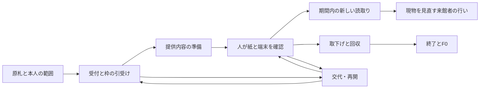

# functional-structure: 引受け・提供確認・回収を繋ぐ仕事

## 依頼と粒度

| 依頼した層と決めるもの | 何のため | 求めた粒度 | この材料で満たしたか |
| --- | --- | --- | --- |
| [how-to-buildの設計](../how-to-build/README.md#材料への依頼) | 体験/規則/保存を仕事の責務と受渡しへ結ぶ | 同じQ17の一巡と失敗・交代・終了 | 下記の前提/入出力と有限例。class/service分割は選んでいない |

## 中身

### 一巡から取り出した責任

体験の場面→必要な結果→その根拠を確認する仕事、の順で構成した。画面やtableごとに機能を増やさず、同じ採否を二つの仕事で決めない。

| 仕事 | 始まる根拠と入力 | 成立させる結果/責任の外 |
| --- | --- | --- |
| 受付と出力枠の引受け | 運営が原札/本人の範囲/出所を確認、本文/number/receipt/確認完了時刻 | s2を使い同じ対象の後の枠と累積4件以内を原子的に確定、又は未受理の理由。紙を実際に出した結果ではない |
| 提供内容の準備と読取り | 予約枠・不変の本文・展示場所・出所、現在のruntime/epoch | 同じ問IDの画面と紙の内容を組む。棚を展示場所にしない。covered/期限外は本文を返さない。読むだけを投稿として記録しない |
| 紙と端末の提供/取下げの確認 | 人が端末を覆い、現物の紙IDを回収/置き、現行表示を確かめた根拠 | 入替え/回収の未完と完了を保ち、現行state/revと紙の状態を一緒に更新。本人が読んだ/効果が出たとはしない |
| 交代・再開 | 最後にcommitした受付/slot/紙/runtime、現在の時刻と現物 | 再読して確定/未完/不明を分ける。古いrevは拒否して依頼した運営へ再確認を返す。過ぎた枠を完了と補わない |
| 日の終了とF0/集計 | 11:25又は異常、回収した表示/原札/本文の保存物、観測集計 | 土曜は閉じて管理下へ。日曜は個別行/本文/控えとの対応を消し、aggregateと運営の問いだけ残す。OSやプリンタの外にあるコピーは人の点検へ返す |

来館者が現物を見直す行いは外に残り、ソフトウェアの表示成功で代替しない。観察と任意の語りは別の集計へ渡す。

### 同じQ17・失敗・変更で照合

Q17/17/来館者の言葉/土日だけを確認完了10:05で受けると、受付が17の10:20枠とaccepted rev1を返す。準備は同じ情報からQ17-P1と端末表示を作る。担当が現物を確認して提供の状態へ進むと、読取りは17/袋/左室を返す。rev1の別画面は新しい状態を上書きできず、再開の仕事へ現在値と不一致を返す。
取下げで覆いを始めても紙Q17-P1がplacedなら回収未完として残し、受取を再開しない。紙を回収して根拠が返った所でwithdrawnへ。停止して成功応答が無ければreceiptから結果を照合し、同じ枠をもう一つ使わない。
日曜は提供確認の件数と観測の集計を残し、個別prompt/copy/receiptを消す。土曜に閉じたことをF0完了へせず、日曜に残る管理を引き継ぐ。

### 機能の分け方と次の設計への要請

一つの小機能の中にこれらの責任をまとめる案を返す。分散workerやqueueへ分けると紙/画面の確定と再開の受渡しが増え、この版で独立させる根拠が無い。機能の責任は分けても、一機能一serviceにしない。
保存へは受付＋予約のまとまり、同じ対象/dayの外部キー、状態rev/epochとF0の消去を求める。実行構成へはlocalhostの書込みとLANの読取りの分離、起動時covered、時刻と接続切れで古い本文を隠す表示を求める。技術へはこれらの局所の性質を確かめ、現物の確認を自動で済ませたことにしないよう返す。

## 確かめた方法と限界

[体験](experience-sketch.md)、[s2規則](core-logic.md#選定後に育てた規則s2)、[情報構造](data-model/README.md)の同じQ17/17/10:20/Q17-P1/revを往復して、次の担当が使える意味を照合した。根拠の無い完了は未完へ返す。実際の施設・人の行いの観測は無い。
