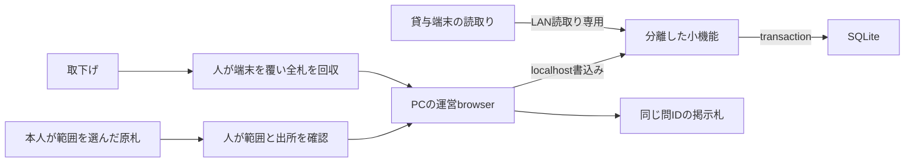

# implementation-structure: 分離した局所構成と公開QRの境界

現在の設計は[選定後の具体](#選定後の実装へ渡す具体の構成)を読む。初回の候補比較と当時の未確認は履歴として保ち、採用済みの根拠へ読み替えない。

## 依頼と粒度

| 依頼した層と決めるもの | 何のため | 求めた粒度 | この材料で満たしたか |
| --- | --- | --- | --- |
| [how-to-solveの構成比較](../how-to-solve/README.md#3-補う点ごとに選択肢を出す) | 確定・再開・消去の保証と部品・負担を比較 | K/Q/Rの実行・保存・接続の境界 | 比較を返す。PCのPython/browserとLANは合成設定で受領。実施設の検査ではない |
| [how-to-buildの実行構成](../how-to-build/README.md#材料への依頼) | 保存/HTTP/紙と端末の確認を実装と再開へ結ぶ | 入口・設定・確定/再開・実装後の受入れ | [具体の構成](implementation-structure.md#選定後の実装へ渡す具体の構成)。全製品/施設実機は未実施 |

## 変えた所

| 変えた所 | 前の姿 | 変えた理由 | 前に読んだ依頼 |
| --- | --- | --- | --- |
| PCの実行環境とLANの条件 | 合成設定としても未取得。施設の実測は無し | [how-to-solve論点1の応答](../how-to-solve/discussion.md)でPython/browser/LAN接続可能の合成設定を受領。実測へ替えていない | [候補比較](../how-to-solve/README.md#3-補う点ごとに選択肢を出す)へ返し、Kの比較条件だけ更新 |

## 中身

### 必要な保証から組む構成

Kでは、PC上に分離した小機能とSQLiteファイルを置く。管理の書込みはPCのlocalhostだけ、貸与端末には同じLANで読取り専用の口だけを開く。元catalogは読取り専用の採用snapshotとして保持し、shelfやnumberを変更しない。展示場所・問い・提供状態は別に置く。

端末の既表示と紙は人が覆い・回収・現行確認を行う。DBの確定だけで物理的な消去とはしない。

受領の確定はSQLiteのcommit、実際の提供は端末の現行表示と紙を置いた人の確認。回収はDBの行だけで確定させず、対象の紙と端末へ結ぶ。停止・再起動では確定した受付キー・状態・revを再読し、結果が不明なら再送前に照合する。
二つの管理画面が同じrevを読んでも、UPDATEの条件と変更行数で古い方を拒否する。[技術の局所結果](technical-feasibility/README.md)はその条件を支えるが、HTTP・LAN・browser・プリンタの成立は未確認。

### 同じ停止・変更での差

Kは回収対象を一台と管理された紙に限定できる。公開QRのQは来館者端末の保存・離れた所での読取り・書込みを扱う必要があり、同じ覆う手順で新たな受取を止められない。本番サイトの変更や公開先を未取得のまま、Kの局所成功でQを成立させない。
Rは貸与端末で事前の運営の問いを読む単一HTML等へ小さくでき、来館者の言葉をデジタル保存しない。取下げと引継ぎは紙の基準に残るので、Kの一元管理の便益を持たない。
PCが止まるKでは新しい言葉を受領・提供せず、端末を覆って紙を回収し、確認できる公開説明だけの通常鑑賞へ戻す。復旧しても不明な紙の提供完了を推測しない。Rも画面停止時は紙の基準に戻るが、古い運営の問いの期限を人が確かめる。

### 費用へ返す部品と不足

K: 永続保存と受付キー、管理の受領・承認・取下げ、読取り画面、紙札と問IDの対応、期限終了と内容の消去、局所起動・読取りの設定、停止・競合の受入れ。継続の仕事は原札の範囲確認・入力・提供の確認、全ての紙の回収と端末の覆い、定時の見比べ、閉場の終了と消去。
Qはこれに公開配置・認証/不正入力対処・個人端末のキャッシュ/接続・外からの入力と保存範囲の扱いが増える。既存の本番構成と料金が不明で金銭と前払いを確定できない。
Rは保存と管理を省ける一方、同じ問IDを紙で追い、人が訂正し続ける仕事を省かない。

## 確かめた方法と限界

同じQ17・rev1→2→3・commit前後停止・取下げ・棚と展示場所の差で責任を照合。構成案であり実装済みではない。PCでPython3/browserを動かせ、貸与端末がLANの読取り口へ接続できることは[合成提供設定](../how-to-solve/discussion.md)として受領した。実施設での接続・実機の受入れは未実施。必要な材料と部品・人の行いを依頼側へ返し、ここで方式を選ばない。

## 選定後の実装へ渡す具体の構成

[how-to-buildの依頼](../how-to-build/README.md#材料への依頼)で、K-S/F0と[機能の入出力](functional-structure.md)、[情報モデル](data-model/README.md)、s2を受けた。上のQ/Rは比較の履歴で、現在の実装基準はこの節。

### 実行・確定・接続

一つのPC上の独立した小アプリとSQLiteファイル、PCの運営browser、LANの貸与端末browser一台を使う。元の公開サイトのrepositoryを改修せず、分離した新規の保守先を後続が用意する。catalogの採用snapshotは[案件内の写し](technical-feasibility/existing-site/catalog.json)で同定でき、公開の説明を流用する範囲だけ。画像も実在のネットワーク設定も持たない。

| 実行の口/契機 | 読む物・確定する結果 | 接続/設定と停止後の根拠 |
| --- | --- | --- |
| PCのlocalhost管理口 | 原札/本人の選択から受付キー・s2の予約、状態rev、紙の確認を確定 | loopbackにだけbind。書込みに起動ごとのランダムtokenと同じOrigin/Hostを要求し、tokenは記録/URL/logに残さない。二つの画面の旧revは409で再読 |
| LANの読取り専用口 | runtime.mode/epoch、対象日/時刻、activeの問いと展示場所を読み、本文を返す/返さないを決める | GETだけ。全POSTは拒否、管理画面/原札/受付キーは出さない。private端末用QRは配らず、貸与端末だけで使う |
| 起動/受付/各表示取得 | PCの掲示と一致する現地の日付と時刻、現在のday/mode | 2026-11-28/29の10:00〜11:25だけ読取り可。受付は10:00〜11:10と5分の余地。時計変更や別の日はcoveredへ。UTCへ勝手に読み替えず、掲示とPC時計の一致を起動時と更新時に二人が確かめる |
| 終了とF0 | covered/ended、紙と本文の残存、観測のaggregate | DBはsecure_delete=ON/journal=DELETE、本文の外部backupを作らない。終了で個別行を消しVACUUM。紙/印刷ジョブ/保存HTML/PDF/画面は人が点検し、DBだけで消したとしない |

実装はPython標準libraryのHTTPとsqlite3で成立させる小構成を基準にする。frameworkの採用等は同じ入出力・検査を保つ裁量。ブラウザに本文を入れる時はtextContent又は文脈に合うescapeを使い、来館者の文字列をHTMLとして実行しない。サーバlogへ本文・受付キー・範囲選択の原文を出さない。入力/出力の上限と予約・revの検査はserverで行い、画面だけの制御にしない。

### 具体のAPIと保存の境界

- `POST /receipts`（管理のみ）: receipt_key/number/body/source/scope/expected_runtime_epochと運営の確認を受け、確認完了時刻はserverで取る。同じdigestの再送は既存結果、新規は受理+対象/dayの枠を一transactionで確定。枠無し/締切は引受けない理由を返す。別内容の同じキーは409、終了後410。
- `POST /cycles/begin` と `POST /cycles/confirm`: 先に端末を覆ってmode=covered。旧札の回収、同じ問IDの新札/現在画面の一致を担当が確認してから、当該枠のcurrent_display/state/rev/paper_copy/runtime.epochを確定する。未確認ならopenにしない。『来館者が読んだ』は返さない。
- `POST /withdrawals/begin` と `POST /withdrawals/confirm`: 控え又は原札で対象を特定し、先に覆う。新GETを止め、全ての該当コピーの回収を確かめてからwithdrawnとする。旧revは409。本文を勝手に直さず、新しい本文は別の本人確認と引受けへ戻す。
- `GET /view`: source/問ID/number/title/location/text/epochを返す。shelfは現物の案内に使わない。covered/期限外/接続失敗は本文を返さず、`Cache-Control: no-store`。clientは取得前に旧内容を隠し、失敗時に古い内容を残さず、閉じる/一定の無操作で消す。休止と終了は自由な通常鑑賞へ戻れる文言にする。
- `POST /days/close` と `POST /purge`: 11:25にmodeを閉じる。土曜は紙/画面を回収し原札とDBを管理下へ。日曜は集計→回収確認→個別行と本文/キーの消去→残存検査を行い、endedを保持する。部分未完は残件として返し、成功と出さない。

これらは実装用の入力/結果であり、probeの簡略endpointが製品API一式を実装済みという意味ではない。認証・入力/出力の全境界・client画面と実機の受入れは後続実装で行う。

### 失敗・中断からの継続

commit前の停止は全体がrollback、commit後に応答だけ失った場合はreceipt/状態を再読して同じ結果へ戻る。どちらも成功応答が無いことだけで二重に受理しない。DBが読めない/壊れた時は端末を覆い新しい受理を止め、紙と最後に確かめた現物だけから残件を照合する。backupから本文を勝手に復活させない。
再起動は常にcovered。過ぎた枠のacceptedを提供済みにせず、未提供として明示。後の同じ対象の枠・締切・余地が揃う範囲だけを再確認し、無い分は不足として選定へ返す。停止で測りができなかった時間は欠測にする。
印刷の失敗はコピーIDの実在を確かめるまで置かず、印刷物が増えた時は全てをcopyの回収対象にする。余分な保存ファイル/PDFを作らず、待機ジョブを点検する。本文の保持を制御できる設定か実機で確かめられなければ、既存カードへの手書きを使う。原札24枚+最大24枚の手書き掲示で48/50枚、運営作成の初期札は普通紙を使える。手書きの追加負担が採った時間配置を崩す時は選定へ返し、無条件に同じ時間内としない。

### 裏づけと実装後の受入れ

取得済みは[SQLite/HTTP/配分/モデルの局所検査](technical-feasibility/README.md)。Q17/17/左室、10:20枠、Q17-P1、旧rev拒否と終了後の個別行0を同じ値で繋げた。現物の紙・貸与端末・施設LAN/プリンタ・全製品の実装は未実施。
起動時の時計/対象日、LANから管理の書込みができないこと、token/Origin拒否、二画面の409、再送/停止、接続切れで本文が消えること、紙と画面の確認を飛ばしてopenにできないこと、期日/終了、F0の保存物と印刷の残存を、下の[受入れと運用](../how-to-build/operations-and-acceptance.md)で実装後に確かめる。実測していないものを既に合格とはしない。
