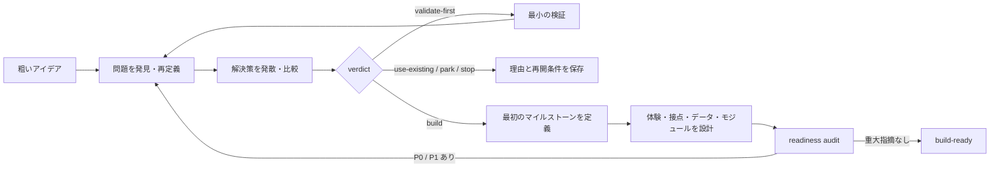

# 運用モデル

## 目的

このラボは、着想の生成ではなく、着想の後に残る詰将棋を引き受ける。アイデアを受け取ったエージェントは、作る価値、解決策の選択、最初のマイルストーン、実装へ渡すプロダクト仕様を一続きで収束させる。

利用者が担うのは、本人にしかない動機、許容できる費用やリスク、ブランドや倫理上の選好である。外部から調べられる事実、比較、可逆な設計判断、文書化、自己レビューはエージェントが担う。

## レールの全体像



この流れは一直線のウォーターフォールではない。監査や検証で前提が崩れたら、影響を受ける最上流の正本へ戻る。一方、未決事項に依存しない調査や記述は止めずに完了させる。

## 状態

各アイデアの `README.md` frontmatter に、次のいずれかを一つだけ置く。

| status | 到達状態 |
| --- | --- |
| `captured` | 元のアイデアと既知の制約を保存した |
| `discovering` | 問題、利用状況、既存手段、根拠を調査中 |
| `deciding` | 解決策と build / non-build verdict を比較中 |
| `defining` | 最初のマイルストーンとプロダクト仕様を定義中 |
| `auditing` | 追跡可能性と重大手戻りリスクを監査中 |
| `waiting-for-owner` | ユーザーにしか決められない高影響事項だけが残る |
| `experiment-ready` | `validate-first` の検証計画が実行可能 |
| `adopt-ready` | `use-existing` の採用・移行・運用手順が実行可能 |
| `build-ready` | 実装へ渡せる |
| `parked` | 再開条件付きで保留した |
| `stopped` | 理由を明示して終了した |

状態は作業量ではなく到達条件を表す。たとえば競合を10件列挙しても、現在の代替手段と比較できなければ `discovering` を抜けない。

## アイデアごとの正本

| file | 読み手ができるようになること |
| --- | --- |
| `README.md` | 現在地、verdict、次の一手、残る判断を1分で把握する |
| `source.md` | 元の発言と、後から得た制約・動機を区別して確認する |
| `discovery.md` | 誰のどの状況にどんな問題があり、現在どう対処しているかを根拠付きで判断する |
| `product.md` | build以外を含む代案から、何をなぜ選び、どこまで作るかを判断する |
| `specification.md` | 最初のマイルストーンの体験、接点、データ、モジュールを実装判断なしでたどる |
| `handoff.md` | 根拠から受入条件までのつながり、残るリスク、実装への入力を検査する |
| `retrospective.md` | 次のアイデアでレールを改善する材料を得る |

議論のログを正本にしない。採用した結論と、将来同じ判断をやり直さないために必要な代案・棄却理由だけを該当ファイルへ残す。

## 品質ゲート

### Gate 1: 問題を作り物にしていない

次を具体例で説明できること。

- 対象者を年齢や職業だけでなく、問題が起きる状況と行動で定義している。
- 達成したい進歩、現在の手順、引き金、頻度、深刻さ、現在払っている費用のうち、意思決定に必要なものが分かる。
- 事実と推論を分け、各主張の証拠強度を表示している。
- 直接のユーザー調査がない場合、その欠落を明示し、調査だけで「需要がある」と断定していない。

悪い例は「忙しい30代会社員は献立に困っている」。良い例は「平日18時以降に、冷蔵庫の在庫を正確に覚えていない状態で夕食を決める人が、候補探索と不足食材の買い足しに毎回20分を使う。ただし20分という値は本人の3日間の行動記録だけに基づく」のように、状況、行動、費用、根拠範囲が分かる記述である。

### Gate 2: 最初の解決策を特権化していない

少なくとも次を同じ目的に対する手段として比較する。

- 何もしない、または運用だけ変える
- 既存製品を使う
- 複数の既存手段を組み合わせる、設定や自動化を足す
- 狭く作る
- 必要な場合だけ広く作る

候補数を満たすための偽物の対案は作らない。各案について、利用者の成果、初期構築費、継続費、切替費、制御性、失敗時の損失を比較する。金額が取れなければ、時間、手作業回数、外部依存、保守箇所を単位にする。

### Gate 3: verdict が根拠と整合する

`build` は情熱だけでも市場規模だけでも決めない。望ましさ、実現可能性、継続可能性のうち、失敗すれば案が崩れる仮説を特定し、影響と証拠強度で優先する。

高影響・低根拠の仮説が、最初のマイルストーンを作るより安く検証できるなら `validate-first` にする。検証には仮説、反証可能な成功・失敗基準、対象、手順、期間または件数、結果別の次の判断を含める。

### Gate 4: 最初のマイルストーンが学習と価値を両立する

マイルストーンは機能数ではなく、利用者が開始から価値獲得まで完了できる縦の一切れとして定義する。運用で後から直せるものを切り離し、後から変えると高くつくものを先に決める。

次を境界として書く。

- 誰が、どの引き金で使い始め、どの結果を得たら完了か
- 含めるシナリオと、明示的に含めないシナリオ
- 手動運用で補う箇所と、プロダクトで保証する箇所
- 成功を観測する指標と、運用へ移してよい条件

### Gate 5: 実装の四つの骨格がつながる

ソフトウェアプロダクトでは、少なくとも次を確定する。

1. 体験: 王道、重要な分岐、失敗、復旧を時系列で示す。
2. 画面または接点: 各ステップを担う画面、CLI command、API、通知、手動運用を対応づける。UIでは画面遷移、主要画面の低忠実度構成、共通UI規則まで決める。
3. 核心ルールとデータ: 入出力の具体例、境界条件、状態遷移、所有者、整合性、保持・削除を示す。
4. バックエンドモジュール: 責務、公開境界、依存、外部連携、失敗処理を示す。

対象に該当しない骨格は `not-applicable` と理由を書く。空欄や「なし」で済ませず、代わりに実装判断を担う成果物を示す。たとえばCLIなら画面一覧の代わりにcommandと入出力の対応、静的サイトならテーブル構成の代わりにcontent schemaと生成経路を置く。

核心ルールは「実装しながら調整する」に残さない。推薦、分類、優先順位、料金、権限、スケジュールなどプロダクトの結果を決めるロジックは、代表例、境界例、反例を通して仕様化する。実測でしか決まらない性能値やmodel品質は、技術spikeまたはfirst milestone後の学習境界として明示する。

### Gate 6: 実装者がプロダクト判断をしない

`handoff.md` で、次の連鎖を双方向にたどれること。

```text
根拠 → 問題 → 期待する成果 → 要件 → 体験 → 接点 → データ / モジュール → 受入条件
```

孤立した画面、使われないデータ、根拠のない要件、受入条件のない重要分岐があれば上流へ戻す。実装技術の細部は後続の設計 skill へ委ねられるが、技術選択でプロダクト挙動が変わる部分はこのラボで決める。

## readiness audit

`build-ready` の直前に、成果物の作成者自身が厳しい反証レビューを行う。レビューの問いは「欠けた項目があるか」ではなく、「このまま作ったら、何が大手戻りを起こすか」である。

### 重大度

| severity | 意味 | 処置 |
| --- | --- | --- |
| P0 | 作る理由、対象、法令・安全性、核心的な実現可能性が崩れる | buildを止め、discoveryまたはdecisionへ戻る |
| P1 | 主要体験、データ境界、画面構成、モジュール境界の大幅な作り直しになる | `build-ready` にせず、該当正本へ戻る |
| P2 | 一つの機能や局所設計で修正できる | 修正後に影響範囲だけ再監査する |
| P3 | 表現や補足の改善 | 読み違いを生む場合だけ修正する |

### 必須の攻撃

1. pre-mortem: リリース後に使われない、維持できない、事故が起きたと仮定し、もっともらしい原因を挙げる。
2. 代案反証: 選んだ案を、最有力の非build案と再比較する。
3. 変更耐性: 利用量、対象者、外部依存、料金、データ保持のうち関連する三つ以上を変化させ、どこが壊れるか確認する。
4. 失敗と復旧: タイムアウト、重複実行、不完全入力、権限不足、外部サービス停止、ユーザーの中断から関連するものを具体データで通す。
5. 追跡可能性: 根拠から受入条件までと、受入条件から根拠までをたどる。
6. 実装者シミュレーション: 初見の実装者として仕様を読み、追加判断が必要な箇所を列挙する。

P0またはP1が一つでも見つかったら、指摘を `handoff.md` に残すだけで終えない。原因が生まれた最上流の正本を直し、影響するゲートを再実行する。P0/P1がゼロになるまで反復する。

## ユーザーへ返す未決事項

質問を出すのは、次をすべて満たす事項だけである。

- repository、Web、利用可能なデータ、論理的帰結から取得できない。
- ユーザーの動機、費用・リスク許容、好み、倫理、アクセス権に属する。
- 答えによって verdict、マイルストーン、主要体験、取り返しのつかない設計が変わる。
- 可逆な暫定案を採っても安全に進められない。

質問ごとに、なぜ必要か、推奨案、推奨理由、答えによって変わる範囲を添える。未決事項に依存しない作業を残したまま質問しない。複数の質問は、共通する上位判断へまとめられるか確認してから一度に返す。

## ラボの改善ループ

各アイデアの完了時に `retrospective.md` を埋める。共有の型へ昇格する候補は、次のいずれかである。

- 性質の異なる二件以上で同じ迷いまたは欠落が起きた。
- 一件でもP0/P1の手戻りを生んだ。
- 手順を変えたことで、同じ品質を明確に少ない作業で達成できた。

改善案は、起点となったケースと性質の異なる二件以上へ当てる。必要なケースだけに効くなら、共通必須手順ではなくvariantまたは選択条件として残す。共有の型を厚くすること自体を改善とみなさない。
