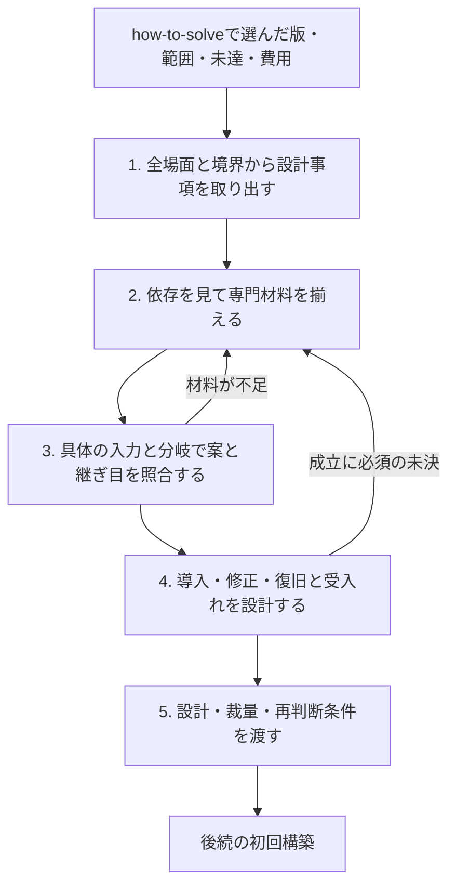

# どう作るか（how-to-build）

## この層の閉じ

how-to-solveで選んだ版を、実装担当が本質的な振舞いを発明し直さずに作り始められる設計へ具体化する。
選んだ設計と理由、守る条件への対応、導入・修正・復旧、委ねる裁量と再判断する境界を、利用者と受け入れる。
決めるものは、次の一つである。

- 実装・導入へ渡す設計

受け取るのは、whatの条件と、how-to-solveで選んだ解き方・今回届ける範囲・受け入れた未達と損失・費用・運用の担い手である。
whyで選んだ価値は、その設計が何を支えるかを読む起点になる。

通常版・実験版を問わず、whyの測りを実施するために必要な観測対象・範囲と欠測、担当・時期・収集の許容範囲と負担も受け取る。選んだ版の中で観測の行いと根拠を繋ぎ、取得できないなら代替観測と限界を示すかwhyへ返す。機能の受入れと実利用の価値の観測を混ぜない。
部分案なら、その版に必要な条件と行いを設計し、全体目標に残る未達を消さない。
設計中に、今回届ける改善・範囲・費用・人の負担が選定の決め手を変えるなら、その差をhow-to-solveへ返す。条件や価値自体を変える不足は、共通READMEの「閉じた層への差し戻し」に従い、その判断を持つ層へ返す。
独立した「どこまで作るか」を挟んで版を切り直さない。

設計を閉じるための不足と、その版を使って初めて観測できる未知を区別する。
例えば、外部での処理結果が不明な時にどう続けるかが未決なら、設計の不足である。
暮らしの負担が実際にどれだけ減るかは、設計や机上検査だけでは実測できない。
その未知を確かめる実験版をhow-to-solveで選んだなら、観測するもの・時期・受入れと見直しの扱いまで設計して渡す。
未確認の効果を得られたことにせず、必要な設計を「作ってから考える」へ追い出す理由にもしない。

## 実装・導入へ渡す設計

### 何を決めるか

選んだ版を使う一巡で、誰が何を受け取り、何を判断・操作し、情報と状態がどう変わり、外の結果を次の誰がどう使うかを決める。
その振舞いを支える情報・処理の責務・接続と運用を繋ぎ、採った構成と理由を残す。
画面・テーブル・moduleの名前が揃うことと、その版の仕事が最後まで成立することは異なる。
画面を持たない処理でも、人が外の道具で行う部分でも、同じ一巡の中に置く。

説明用に、学校の用件を一覧へ入力し、scriptで次の行いの予定を作る版をhow-to-solveで選んだ、と仮定する。
これは方法を読むための仮説であり、実際の製品の選定や検証済みの設計ではない。
その版の設計には、用件の受付、家族の選択と引受け、予定の作成、署名・原本の提出までの関係が要る。
一覧の「済み」が、署名済みなのか、原本の提出済みなのかを実装担当が決め直す状態では、渡せる設計になっていない。

正本には設計の要点と判断理由、受入れ・導入・修正・復旧、裁量と再判断を渡す。
詳しい体験・情報・処理・技術の材料は、そのproduct directory内へ結ぶ。
実装の最初のtasklistや実行は後続の`steering`／`task-design`へ渡す。
実際の作業の権限は、その後続作業の指示に従う。

### 決め方

五つの段は必要な働きを分けたものであり、一度ずつ通す固定の直列工程ではない。
不足が出れば、その不足を解く材料・判断へ戻す。画面数、専門の数、案の数も固定しない。

図の戻り先は代表である。場面の抜けなら1へ、案の矛盾なら3へ戻す。
選定の決め手が変わる差は、どの段で見つかってもhow-to-solveへ返し、選び直した版から影響する設計を更新する。

#### 1. 選んだ版の一巡から、設計すべき判断を取り出す

how-to-solveの選定とwhatの条件を読み、まず対象の全場面と境界を並べる。
利用を始める時、日常の対応、選んだ版で扱う変更や引継ぎ、終える時を、その版に必要な範囲で見る。
代表的な一件へ早く降りるために、他の場面を無かったことにしない。
場面ごとに、始まるきっかけ、受け取るもの、担う人・仕組み、外へ渡る結果、終わったと分かる根拠を置く。
作る部分の外にある行いも残す。外部APIへ送った所や人へ通知した所で、一巡を切らない。

学校の仮の版なら、原本を受ける、参加を選ぶ、引き受ける、予定を作る、署名する、学校へ原本を渡す、という行いを並べる。
原本の締切が変わる場面と担当が不在になる場面も、その版が扱うなら含める。
誰かが一覧へ入力するだけで家族の引受けまで成立したとせず、誰が何を見て引き受けたと分かるかを問う。
提出が必要な条件へ対応する設計は、予定や署名の済みだけでなく、原本の提出の根拠へ繋げる。

この一巡から、設計で答えるべき問いを取り出す。
例えば、原本と一覧のどちらを現行とするか、引受けと完了をどの出来事で変えるか、外部へ渡す情報は何かである。
条件との対応は、どの場面の何がその条件を支えるかで示す。全体目標で今回見送った所は、how-to-solveの未達として読み分ける。
ここで得るのは全機能の名前ではなく、専門へ渡して解ける設計の判断である。
「提出条件は提出moduleで対応する」と名前だけで対応付けたら、そのmoduleが何を受け何を成立させるかへ戻る。

- 揃えば満たした: 対象の全場面と境界が並び、選んだ版に必要な条件から、誰のどの行い・状態・完了の根拠を設計するかを辿れる。必要な問いと、how-to-solveで受け入れた未達を読み分けられる。

#### 2. 必要な専門材料を、依存と粒度を持って揃える

取り出した問いごとに、何が分かれば設計を選べるかと、どの専門材料がそれを支えるかを定める。
依頼には、選んだ版の目的・範囲・未達、対象場面と条件、既に決まった境界、まだ決められない問い、返してほしい判断材料を渡す。
相手に全体を推察させず、その材料をどの次の判断に使うかを明示する。
独立に育てられる材料は並べて育て、他を規定する判断は先に確かめる。

| 設計の問い | 必要になる材料の働き |
| --- | --- |
| 想定する人が何を理解し引き受け、何を完了として扱うか | 経験の材料が、提供記録や他者の語りから実際の経過・認識と未確認を返す。操作の希望や予定を、引受け・完了へ補わない |
| 誰が何を見て、判断・操作し、次へ渡せるか | 体験の材料が、表示・操作と外の行いを繋ぐ。見えるものだけで完了を作らない |
| 何を根拠に、どの結果・次の行いを決めるか | 中核logicの材料が、入力・規則・例外と結果を示す。名前だけの「最適化」へしない |
| 何を保存し、どれを現行とし、何を区別して保つか | 情報構造の材料が、同一性・状態・履歴と更新の根拠を支える |
| どの処理が何を受け、どこまで責任を持つか | 処理の材料が、責務・受渡し・失敗時の扱いを分ける |
| どこで実行・保存・接続し、停止や競合の後に何を根拠に続けるか | 実装構成の材料が、確定と継続の境界から案を育て、同じ入力・停止・変更で差・根拠・不足と費用の部品を返す |
| 選ぶ設計が当てにする外部の性質は実在するか | 技術の材料が、確認した条件・結果・限界を返す。期待するAPIの存在を事実にしない |

これは全てを別file・別skillにする指定ではない。選んだ版の判断に必要な材料を依頼するための分け方である。
専門の仕事の詳細な方法は、その専門が持つ。層は依頼と受領・照合・選定を持ち、表の各欄を自分の思いつきで埋めて専門材料の代わりにしない。
現行で使える材料skillは`propose-alternatives`、`sketch-experience`、`design-core-logic`、`design-data-model`、`functional-structure-design`、`implementation-structure-design`、`verify-technical-feasibility`、`gather-target-user-voices`である。
人の行い・認識の前提が設計を左右し、既存の体験・記録だけでは足りない時は、`gather-target-user-voices`へ対象の人・場面、選んだ版と設計の問い、既知の記録と求める根拠の粒度を渡す。
返った経験は、体験・規則・情報のどの前提を支持又は疑わせるかへ照合し、同じ版の設計案を3で試す材料にする。
例えば「知らせを読んだ」という記述だけで、相手の引受け済みという状態を作らない。
別の人の経過は本件の実利用や効果の保証にはせず、本人の事実と設計に必須の不足は、その根拠を得る先へ戻す。
選定の決め手や価値・条件を変える差は、共通の差し戻しへ返す。
実装構成の違いが保証・応答・人の負担や費用を変える時は、選んだ版の場面と条件、機能・規則・情報、既知の技術と制約、比較又は詳細の粒度を渡す。既存の材料で構成と根拠が揃う所へ、同じ案の作り直しを一律に足さない。
返った構成は、同じ一件・停止・変更で残る情報から次の行いを辿れる根拠と、他の専門の結果へ照合して受ける。技術名や箱の図だけなら不足を返す。必要な技術の問いは技術検証へ、部品・配置・連携・訂正・復旧と継続の行いは、選定と同じ対象場面・比較期間、既存の見積りと増減の根拠とともにpropose-alternativesへ渡し、必要な部分の費用と負担を更新する。期間や回数が未確認ならその不足を残し、年の値へ無根拠に外挿しない。以前読んだ値が変わる時は共通の変更通知を使う。選定の決め手を変える差はhow-to-solveへ返し、構成の専門に受容を代行させない。
使えるskillの一覧と、個別の版で必要な材料・判断・検証が揃ったことは分ける。
一覧に無い専門が不可欠なら、その不足を吟味へ返す。必要な材料や成立の裏づけが無いまま、この層を閉じない。

学校の仮の版では、外部予定の結果不明を扱う方法が、情報の持ち方と処理の分け方を規定する。
相手の予定を照合できる根拠があるかを確かめずに、先にtableとmoduleの形を確定しても設計は成立しない。
技術の材料へは、照合に使う情報を保存・取得できるか、どの条件で見つかるか、見つからない時に何が分かるかを問う。
返った材料が相手側の成功例だけなら、結果保存前の停止を判断するには不足していると返す。
この不足を解いてから情報と処理へ戻すことで、専門の成果が単体で良く見えるだけの状態を避ける。

- 揃えば満たした: 設計を選ぶために必要な専門材料が、対象・依存・粒度を持って揃い、何の判断に使うかを示せる。材料の未整備・未確認は不足として残り、実在しない結果で埋めていない。

#### 3. 設計の案を同じ一件へ当て、継ぎ目を照合して選ぶ

既存の共用物を変える設計では、how-to-solveで調べた既存の利用者と守る意味・移行の採否を受け取り、新機能と既存の別業務の代表例を両方通す。選定時に見えなかった利用箇所は変更対象から調べる。旧番号が存在するだけで互換とせず、同じ対象・操作・結果を意味するかを確かめ、移行担当・負担・終了まで設計する。採否や費用が変われば選定へ戻す。

集まった材料から、選んだ版を成立させる構成を組む。
違いに意味がある案は、同じ入力・出来事と同じ条件へ当てて比べる。
既存道具を使うか自作するかを無条件に選び直すのでなく、選んだ版の中で、状態の持ち方や処理・人の分担が何を変えるかを見る。
形式のために案を増やさず、選定に効く別案や既知の定石があるなら落とさない。

一件の具体の値を置き、操作、記録、状態の変化、処理、外の結果、次の行いまで往復して辿る。
材料同士の接続は、同じ言葉があるかでなく、次の担当が前の出力を使って判断・実施できるかで照合する。
材料が返った時と、材料の組合せ・依った前提が変わった時に、採否を左右する主張を、その版の場面へ戻して受け取る。
規則/条件の本文・版と開始状態から、対象の分岐へ届く経過、応答と結果を照合した根拠を辿る。
その判断・行いを担う人や仕組みが、必要な時点に、何をどの方法で得て次を選べるかを確かめる。
「確認できたら進む」設計なら、確認に要る表示や値がその確認より前に得られる順序と権限があるかを読む。確認済みのflagや検査者だけが知る対象IDを先に与え、その後の処理だけが成功しても、この前提の成立には数えない。

開始状態には、今回の判断に効く初期投入・既存データ・未処理の仕事を含める。空の表や通常の一件だけで確かめた性質を、それらがある版へ広げない。
部品の性質を確かめるために仮の状態や正解の値を入力すること自体は妨げない。その結果で支えられる範囲と、当事者がその前提を作れることの未確認を分けて受け取る。
提供や更新を許す範囲を守れるという主張では、許された相手・対象・行い・時点と、実際に許す/拒む仕組みの識別単位を照らす。接続できることや書込みを防げることだけを、特定の相手にだけ読ませられる根拠へ替えない。

復旧や交代の根拠は、その時点で担当へ残る情報だけから辿る。同じ残存情報になるのに必要な対象や次の行いが異なる経過があれば、それを判別する根拠が欠けている。対象を知る検査者が代わりに選んで続きを成功させない。
不正な入力を正しく拒否した例と誤って受け付けた例、途中で止まる例と末尾まで成立する例を混ぜない。期待値の転記や「検査済み」という表示だけでは受けず、不足する根拠とそれが左右する判断を当該材料へ返し、その判断を未確認として残す。
共通の根拠は参照して使い、同じ対象・版・条件で足りる検査を繰り返さない。全例の再計算、大きな固定表、本実装や実機の先行完成は一律に求めない。規則/条件自体が割れる場合や、範囲・費用・人の負担が選定の決め手を変える差は、その判断を持つ層へ差し戻す。
1で並べた場面に対応する代表入力と重要な分岐を選び、一件の成功で全場面を見たことにしない。
変更・中断・失敗も、その版の約束が崩れる境界から選ぶ。

例えば、予定を作ってから成功と外部IDを保存する案へ、保存前の停止を当てる。
再開時に未作成と決めて再送すると重複し、成功と決めつけると実際には未作成の場合を落とす。
この案では、手元の空欄だけから外部の結果を判断できない。

別の枝として、外へ出す前に対象用件とその版・実施中を記録し、取り残された実施中を結果不明として照合する設計がある。
その枝も記録欄を足すだけでは完成しない。
何を使って相手側の予定を見分け、誰がいつ照合し、重複や未作成をどう訂正するかまで要る。
APIや道具がその照合を支えるかは、取得した技術の材料で確かめる。ここに書いた枝が実装・検証済みの解ではない。
手動で照合する設計もあり得るが、その負担を選んだ版へ照らす。

比較では、どの案がどの条件をどう支え、何が脆く、どんな手間・費用が増えるかを示して選ぶ。
受け入れた未達や利用者の負担を変える判断は、利用者に黙って代行しない。
案を選べなければ不足する材料へ戻す。設計で選定の決め手が変わったなら、差をhow-to-solveへ返す。
「エラー処理は実装時に考える」「人が適宜確認する」だけが残っていたら、本質的な振舞いの未決が残っている。

- 揃えば満たした: 採った案と理由があり、対象場面を代表する入力・重要な分岐について、操作から状態・処理・外の結果・次の行いまで繋がる根拠を示せる。その根拠を当事者が必要な時点に得られ、採用した開始状態と許された範囲にも対応する。案を左右する材料の不足や、選定へ返す差が未処理で残っていない。

#### 4. 導入・修正・復旧と、受入れの確かめ方を設計する

新規構築と既存製品の改修を区別し、今回手を入れる製品・保守場所・当てにした版又は同定根拠、流用する機能と守る振舞いを引渡しへ残す。実装先の製品版が動いたら、依った前提との差が効く判断だけを再照合する。企画の基準版・変更先の製品版・後続の現在の採否は別に識別する。

日常の一巡に入れる状態をどう作り、そこから誤記・外部の変更・中断が起きた時にどう続けるかを決める。
採った構成について、初期投入・既存情報からの移行、修正・取消し、失敗の検知・照合・再開が必要な所を辿る。
操作を用意するだけでなく、担い手、きっかけ、使う根拠、手順の終わりと負担を繋ぐ。
外で行う作業も、単に「運用で対応」として消さない。

| 学校の仮の版で起こすこと | 設計で答えること |
| --- | --- |
| 導入時に、既に引受け済み・提出済みの用件がある | 誰が原本と既存の結果を確認して初期状態へ入れるか。過去の用件へ新しい予定を重ねて作らない根拠は何か |
| 原本の締切が金曜から木曜へ変わる | 何を現行とし、外の旧予定を誰が更新・取消し、途中で止まればどこから続けるか |
| 外部の予定はできたが、手元の成功記録が無い | 結果不明を誰が何で照合し、未作成・重複を訂正して再開するか |
| 署名は済んだが原本は家に残る | 署名と提出の状態・根拠をどう分け、次の人が残る行いを判断するか |

この表は学校向け機能を全ての版へ要求するものではない。
例えばサブスクの更新前の通知だけを作り、解約は人が外で行う版なら、通知の結果と解約の成立を分けて渡す。
外部解約の自動化をこの層で必須に足さず、人に残る期限・行いと未達を設計の中で保つ。
人の確認が増えてhow-to-solveで受け入れた負担を超えるなら、その増分を戻す。一律に全故障を自動復旧することを求めない。

受入れは、その設計で何を成立と判断するかを、入力・操作・外部の出来事と期待する結果で残す。
例えば期限変更なら、原本の期限を変え、予定の更新途中に停止した時も、何を現行と読み、誰がどの残作業から再開できるかを確かめる。
「復旧できること」だけでは、失敗を検知しただけでも合格にできてしまう。
対象の状態と行いまで書き、どこを実際に検査すればよいかを渡す。

設計を選ぶ前に必要な裏づけの検証と、実装後に行う受入れ試験を区別する。
取得済みの技術の材料には、確かめた条件と結果、未検証の境界を残す。
実装後の試験には入力・手順・期待を渡し、未実施を合格と書かない。
選んだ実験版で実利用後に観測する価値や所要時間にも、観測対象・時期・受入れと見直しの扱いを残す。

- 揃えば満たした: 選んだ版に必要な導入・修正・復旧が、担い手・きっかけ・根拠・終わりと負担まで繋がる。取得済みの検証と、実装後・実利用後に確かめる入力と期待を区別して渡せる。

#### 5. 決めた設計を渡し、裁量と選び直す差を残す

選んだ設計を、理由と条件への対応を含めて正本の「どう作るか」へ渡す。
体験・情報・処理と外との関係を読み取れる要点を正本に置き、詳しい材料と検証結果は同じproduct directory内へ結ぶ。
画面仕様だけ、table定義だけを渡し、どう繋がってこの版の仕事を果たすかを実装担当へ再推論させない。
全ての検討履歴を正本へ重複させず、採った設計と理由から詳細へ辿れる形にする。

| 正本へ渡す節 | 読者が使えるようにするもの |
| --- | --- |
| 選んだ版を成立させる設計 | 選んだ構成と理由、場面・条件への対応、体験・情報・処理・外部の接続 |
| 受け入れの根拠と、導入・修正・復旧 | 取得済みの裏づけと限界、実装後の受入れの入力と期待、導入から再開までの担い手と扱い |
| 設計上の裁量と、再判断する境界 | 委ねる選択、残る未知・先送り、変更するなら既決へ戻す差と条件 |

裁量は、何を保てば実装担当が選んでよいかで示す。
例えば、担当が選べる実装上の分割と、変えれば結果不明の照合の根拠を失う記録の省略を、同じ自由度として渡さない。
本質的な振舞い・情報・責務・失敗時の扱いが未決なら、裁量の欄へ置き換えて閉じない。

残す未知や先送りには、何が残り、なぜ今はその版を成立させられ、いつ・何で見直すかを渡す。
実利用での効果が未知なら、設計の成立と効果の実証を分ける。
設計に必要な技術が未確認なら、今の版の成立を支える別の設計や根拠が無い限り、先送りとして消せない。
その未知を調べるために版自体を変えるなら、how-to-solveへ返してその実験版の範囲・損失・費用を選ぶ。

持出しの出口には、案件と基準版、後続の判断ownerと現在の決定場所の扱いを残す。後続へは、変わった事実・基準版との違い・利用者の採否を追える形で渡す。
場所と更新責任の規則は、`product-plans/README.md`の「持出し後の基準版と現在の採否」に従う。実在する受付記録への接続は後続が行う。

実装用の細かいtasklistをここで完成させる必要はない。
作り始める順や技術上の試作で、届ける範囲や人の負担を黙って変えないよう、戻す境界を渡して後続へ繋ぐ。
後続で差が見つかった時も、選定全体を初めから議論するのでなく、変わった設計・決め手の差を該当する判断へ返す。

- 揃えば満たした: 正本とdirectory内の材料から、選んだ設計・理由・条件への対応、受入れと導入・復旧、委ねる裁量と再判断を読める。残す未知・先送りには理由と見直す条件があり、実装担当へ渡していない本質的な設計の未決が無い。

### 止める時

選んだ版の対象場面を支える設計が繋がり、実装担当が本質的な振舞い・情報・責務・失敗時の扱いを発明し直さずに作り始められる時に止める。
代表入力と重要な分岐を設計へ当てた根拠があり、描かなかった場面を成功例一つで保証したことにしていない。
必要な専門材料と成立の裏づけが揃い、正本から設計・検証の詳細へ辿れ、残す未知と先送りには観測・受入れ・再判断の扱いがある。
この設計とその限界を利用者と受け入れて、層を閉じる。

層fileを定義したこと、画面・table・moduleの欄を埋めたこと、試作の一件が動いたことだけでは閉じない。
退避中の専門材料が不可欠なままなら、その不足を明示して止め、整備・判断・検証へ返す。
逆に、how-to-solveで受け入れた全体目標の未達や、実利用で観測する未知が残ることだけで、選んだ版の設計を永久に未完にしない。
ここで受け入れるのは実装・導入へ渡す設計であり、本実装・実運用の完了ではない。

### この決め方の限界

有限の場面を辿る机上照合では、描かなかった全ての故障まで証明できない。
技術検証も、取得した条件と範囲の裏づけであって、本実装の正しさや実利用の価値を保証しない。
検査する場面は選んだ版の約束が崩れる境界から選び、限界と見直す条件を渡す。
全故障の証明や全技術の先行実装を要求する代わりに、今の設計が不可欠な未決へ依っていないかを確かめる。

方法のfileがあることと、必要な専門が使えること、その材料で個別の版を設計できたことは別である。
この層は専門の詳細な方法を代行せず、実装担当へ肝心な判断を押し出すことも認めない。
本文中の学校や通知の例は、方法が取り出す判断と不足を示す。実際のAPI・運用・利用者で検証済みの解ではない。
